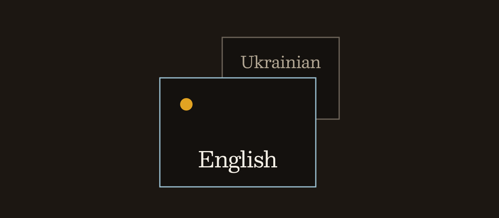

<div align="center">



<br>


# swaylingo

### the binary is `skbd`

**Each Sway window keeps its own keyboard layout.**

Focus Firefox in English. Switch to Telegram and type Ukrainian. Come back. English is already there. You do not press the layout key.

<br>


<br>

Same window rules as swaylingo 0.4.0. This tree builds them in C.
[Try the rules in the browser](https://worxbend.github.io/swaylingo/).

</div>

---

## The rule

Sway keeps one XKB layout for the seat. `skbd` remembers the layout on each window and puts it back on focus. Sway still owns the keymap. Super+Space still switches. Nothing is written to disk.

| When | What you get |
| --- | --- |
| A window you have used | The layout you left it on |
| A window you have not used | Its app rule, or the fallback |
| An empty workspace | The fallback |
| The window that was focused when `skbd` started | The layout Sway is already using |

An X11 dialog copies the layout of the window it belongs to. Firefox is one Sway window, so its tabs share one layout.

```text
Firefox, English
        focus
Telegram, you switch to Ukrainian
        focus
Firefox, English is back
        empty workspace
fallback English
        new Alacritty
fallback English
```

---

## Sway alone, then with skbd

| Sway alone | With `skbd` |
| --- | --- |
| Focus Firefox and switch to Ukrainian. | Firefox stays on the layout you left it on. |
| Focus Telegram. It is still Ukrainian. | Telegram can start in Ukrainian because `[apps]` says so. |
| Switch it back by hand. | Come back to Firefox and English is already there. |
| Open Alacritty. It inherits Ukrainian. | A new Alacritty window starts on the fallback. |
| Switch to an empty workspace. Ukrainian stays. | An empty workspace uses the fallback. |

---

## Three minutes

### 1. Two layouts in Sway

`skbd` switches an index. It does not create layouts. The first name in `xkb_layout` is layout 0.

```
input type:keyboard {
    xkb_layout us,ua
    xkb_options grp:win_space_toggle
}
```

Reload Sway. `us` is English. `ua` is Ukrainian.

### 2. Build and install

You need a C11 compiler, `make`, and POSIX. No third-party libraries. Run this as your user, not root. The unit is a systemd user service.

```bash
make
bash install.sh
```

`make` writes `bin/skbd`. `install.sh` copies that binary, the user unit, and the man page. It does not download a release.

```text
~/.local/bin/skbd
~/.config/systemd/user/skbd.service
~/.local/share/man/man1/skbd.1
```

`XDG_CONFIG_HOME` is used for the unit only when it is an absolute path inside your home directory. Otherwise the unit goes under `~/.config`. The unit is not enabled.

`bash install.sh --self-check` checks the unit text and the path rules. It does not install. It needs no network and no root.

### 3. Start it after Sway is up

`SWAYSOCK` contains Sway's pid. It changes every time Sway starts.

```bash
systemctl --user import-environment SWAYSOCK
systemctl --user restart skbd.service
```

On every Sway start:

```
exec_always "systemctl --user import-environment SWAYSOCK && systemctl --user restart skbd.service"
```

### 4. Optional per-app rule

`~/.config/swaylingo/config.toml` is optional. If `XDG_CONFIG_HOME` is set, the file is `$XDG_CONFIG_HOME/swaylingo/config.toml`. A missing file at that default path is an empty config. Copy `config.example.toml`.

```toml
fallback = "us"

[apps]
Telegram = "ua"
discord = "ua"
jetbrains-idea = "us"
Code = "us"
code = "us"
```

A key is the Wayland `app_id`, or the X11 class. Quote a key that contains a dot, or TOML reads it as a nested table. A wrong key is ignored. Stop `skbd` first, then copy the id from `swaymsg -t get_tree`.

A token is a layout index, the layout's exact name, or a short code: `us`, `en`, `ua`, `uk`, `ru`, `de`, `pl`, `fr`. `us` and `en` prefer a name that contains `(US)`.

Send `SIGHUP` to reload the file. Remembered windows stay. A bad file keeps the rules you already had.

---

## Check it

1. Focus the Firefox window. Press Super+Space until the layout is Ukrainian.
2. Focus the Telegram window. Press Super+Space until the layout is English.
3. Focus Firefox again. Ukrainian is back.
4. Open a new Alacritty window. It starts on the fallback, English.
5. Switch to an empty workspace. The layout returns to the fallback. Firefox is still Ukrainian when you go back.

```bash
systemctl --user status skbd.service
```

Stop the service before you run `~/.local/bin/skbd --verbose` in a terminal. Two copies both try to switch.

---

## Commands

```text
skbd
skbd --verbose
skbd --version
skbd --help
skbd --config PATH
skbd --default TOKEN
```

| Flag | What it does |
| --- | --- |
| `--verbose` | Print focus, layout, and switch lines. |
| `--version` | Print `0.4.1`. |
| `--config PATH` | Read this file. A missing explicit path exits 2. |
| `--default TOKEN` | Override `fallback` for this process. |

`man skbd` is the same contract. Help and version go to stdout and exit 0. An unknown flag exits 2.

| Exit | Meaning |
| --- | --- |
| 0 | Help, version, a clean shutdown, or an empty `SWAYSOCK` under systemd |
| 1 | Sway could not be used, an empty `SWAYSOCK` outside systemd, or you are root |
| 2 | A bad flag, a bad config, or a layout token that matched nothing |

---

## Not this

- One layout per Firefox tab. One window, one layout.
- fcitx5 or ibus. English and Ukrainian here are XKB layouts.
- A file of window ids. Those ids die when Sway exits.
- A downloaded release binary. This tree builds `bin/skbd` and installs that file.

The layout command is `input type:keyboard xkb_switch_layout <index>`.

---

## Troubleshooting

<details>
<summary><code>SWAYSOCK is not set</code></summary>

<br>

The shell is outside Sway, or the user service started before Sway imported the socket. Outside systemd that exits 1. Under systemd the process prints the message and exits 0, so the service does not restart. Import the socket, then start it again.

```bash
echo "$SWAYSOCK"
systemctl --user import-environment SWAYSOCK
systemctl --user restart skbd.service
```

</details>

<details>
<summary>Focus did not change the layout</summary>

<br>

You need at least two names in `xkb_layout`. Reload Sway after you edit it. `pgrep -a skbd` should show one process.

</details>

<details>
<summary>Telegram did not start in Ukrainian</summary>

<br>

The key under `[apps]` did not match the window. Stop the service and copy `app_id`, or the X11 class, from `swaymsg -t get_tree`. A window that was already focused at startup keeps the current layout and does not pick up the app rule. A wrong key is ignored, not an error.

</details>

<details>
<summary>Install says run as your user, not root</summary>

<br>

The unit is a systemd user service. Drop the sudo. `skbd` itself also refuses to run as root.

</details>

---

## Development

```bash
make
make test
make test SANITIZE=1
./bin/skbd --help
```

`make test SANITIZE=1` builds with AddressSanitizer and UndefinedBehaviorSanitizer. Warnings are errors.

| File | Owns |
| --- | --- |
| `src/memory.c` | Which window has which layout, and when to switch |
| `src/config.c` | `fallback`, `[apps]`, and layout tokens |
| `src/sway_ipc.c` | The Sway socket, on two connections |
| `src/json.c` | The JSON that socket speaks |
| `src/main.c` | Arguments, the lock, signals, and the event loop |
| `install.sh` | `~/.local/bin/skbd`, the user unit, and the man page |

Subscribe uses one socket. Commands use the other. A layout switch never shares the event stream.

---

<div align="center">

**Focus Firefox. It should still be in the language you left it in.**

</div>
